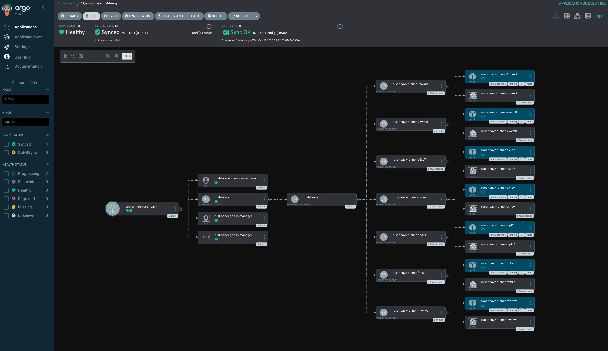

この記事の本文は筆者が執筆し、LLMを使って添削しています。

## はじめに

自宅にProxmox VEを入れた3台のクラスターがあり、そのうち2台でGitHub Actionsのself-hosted runnerのVMを6台と、検証用のVMを動かしていました。

VMのランナーはGitHub-hosted runnerとは異なり、ジョブが終わっても生成物が残ります。
そのため、前のジョブの残骸や手作業で入れたツールによって、結果が変わることもあります。
ジョブごとに作って捨てる構成にしたかったので、Kubernetesを建てて[Actions Runner Controller](https://github.com/actions/actions-runner-controller)（以降ARC）に移行しました。

## 構成

最終的に次の形になりました。

- Proxmox VE ×3
  - Terraform（VMの作成からTalosのbootstrapまで1回のapplyで行う）
    - Talos Linux（control plane ×3 + VIP、worker ×3）
      - Cilium（kube-proxyの置き換え、LoadBalancerのIPをL2で広告）
      - Argo CD（設定用のリポジトリのmainからGitOpsで同期）
      - ARC（ジョブごとにランナーのPodを作成・破棄、0〜12台）

ノードは各Proxmoxホストにcontrol planeとworkerを1台ずつ置きました。
control planeは2コア・4GiBの小さめのVMにして、残りのリソースをworkerに寄せています。

ローカルツールのインストールはすべて`mise.toml`にまとめ、`kubectl`・`talosctl`・`helm`・`terraform`を`mise install`で入れています。
リポジトリ内では`KUBECONFIG`と`TALOSCONFIG`も`[env]`で設定しているので、cdするだけで手元のクラスターを操作できます。

## なぜTalos Linuxか

[Talos Linux](https://www.talos.dev/)はKubernetesを動かすためだけのイミュータブルなOSです。
SSHやシェルはなく、設定はすべてAPI経由でYAMLを渡して行います。

自宅のクラスターはどうしてもその場で修正して以前の変更を忘れることが起きがちなので、OSの設定まで宣言的に書けるのが魅力でした。
k3sやkubeadmと比べると最初の学習コストはありますが、`talosctl`とTerraformのproviderがよくできているので、思ったより苦労しませんでした。

## TerraformでVMとTalosをまとめて作る

Terraformでは2つのproviderを使っています。

- [bpg/proxmox](https://registry.terraform.io/providers/bpg/proxmox/latest): Proxmox VEを操作するproviderで、Talosのイメージのダウンロードと、VMの作成を担当
- [siderolabs/talos](https://registry.terraform.io/providers/siderolabs/talos/latest): Talos Linuxを操作するproviderで、machine configの生成と適用、bootstrap、kubeconfigの取得を担当

`terraform apply`を1回実行すると、VMの作成からKubernetesのクラスターが立ち上がるところまで進みます。

### nocloudイメージで固定IPを渡す

Talosのイメージは[Image Factory](https://factory.talos.dev/)で、`qemu-guest-agent`の拡張機能を入れたものを作っています。
Terraformの中でschematicを作れるので、イメージのURLもコードから組み立てられます。

```hcl
resource "talos_image_factory_schematic" "this" {
  schematic = yamlencode({
    customization = {
      systemExtensions = {
        officialExtensions = data.talos_image_factory_extensions_versions.this.extensions_info[*].name
      }
    }
  })
}

data "talos_image_factory_urls" "this" {
  talos_version     = var.talos_version
  schematic_id      = talos_image_factory_schematic.this.id
  platform          = "nocloud"
  disk_image_format = "qcow2"
}
```

プラットフォームを`nocloud`にしておくと、Proxmoxのcloud-initで渡したIPアドレスをTalosが読んでくれます。
VMの作成時点で固定IPが付いているので、DHCPの払い出しを待たずにmachine configを適用できます。
この機能はかなり便利でした。

### ハマったところ

#### file_idでディスクを作るとSSHが必要になる

bpg/proxmoxでは、`iso`領域にダウンロードした`.img`を`disk.file_id`に指定してVMのディスクを作れます。
ただ、この方法はprovider内部でProxmoxのノードにSSHして取り込むため、SSHの設定をしていないと失敗します。

```
Error: creating custom disk: unable to authenticate user "" over SSH to ...
```

ダウンロード先を`content_type = "import"`にして、ディスクを`import_from`で指定すると、APIだけで完結しました。
ストレージ側でimportのコンテンツが有効になっている必要があります。

```hcl
resource "proxmox_download_file" "talos" {
  for_each = toset([for n in var.nodes : n.pve_node])

  node_name    = each.key
  datastore_id = "local"
  content_type = "import"
  file_name    = "talos-${var.talos_version}-nocloud-amd64.qcow2"
  url          = data.talos_image_factory_urls.this.urls.disk_image
}

resource "proxmox_virtual_environment_vm" "node" {
  # ...
  disk {
    datastore_id = "local-lvm"
    interface    = "scsi0"
    import_from  = proxmox_download_file.talos[each.value.pve_node].id
    size         = each.value.disk_gb
  }
}
```

#### Talos v1.12以降は設定の書き方が変わっている

ネット上の記事を参考にして、インストール先やCNIを`machine.install`や`cluster.network.cni`のpatchで書いたところ、適用時にエラーが出ました。

```
* UnattendedInstallConfig config is incompatible with v1alpha1 config (.machine.install)
* cluster network config is already set in the v1alpha1 config (.machine.cluster.network).
  Please remove it and use only the new KubeNetworkConfig document to avoid conflicts
```

Talos v1.12あたりから、設定の書き方が変わっていました。
v1alpha1の1つのドキュメントにまとまっていた設定が、`UnattendedInstallConfig`や`KubeNetworkConfig`などの個別のドキュメントに分かれています。
`talosctl gen config`で生成したファイルを見ると、ドキュメントの一覧が分かります。

Ciliumを入れるために、Flannelとkube-proxyを無効にしたかったので、次のpatchにしました。

```yaml
apiVersion: v1alpha1
kind: UnattendedInstallConfig
installer:
  image: factory.talos.dev/nocloud-installer/<schematic id>:v1.14.5
provisioning:
  diskSelector:
    match: disk.dev_path == "/dev/sda"
---
# Flannelはドキュメントごと消すと無効になる
apiVersion: v1alpha1
kind: KubeFlannelCNIConfig
$patch: delete
---
apiVersion: v1alpha1
kind: KubeProxyConfig
enabled: false
```

`talosctl gen config`で作った設定には`diskSelector`のデフォルト値が入っていますが、Terraformのproviderで生成した設定には入っていませんでした。
そのため`provisioning.diskSelector.match is required`で一度失敗しています。

control planeのVIPも、`Layer2VIPConfig`という独立したドキュメントで書きます。

```yaml
apiVersion: v1alpha1
kind: Layer2VIPConfig
name: <VIPのアドレス>
link: eth0
```

Proxmoxのvirtio NICは`ens18`になることが多いですが、Talosのnocloudイメージでは`eth0`でした。
`ens18`と書いても別名として解決されてVIPは載りましたが、紛らわしいので`eth0`にしています。

### シークレットは1Passwordから渡す

今回は手元にあるものだけで完結させたかったので、HashiCorp Vaultなどの外部シークレット管理は使わず、1Passwordだけで済ませました。
ProxmoxのAPIトークンは`terraform.tfvars`に書かず、1Passwordに置いて`op run`で環境変数として渡しています。

```sh
# .env.op
TF_VAR_proxmox_api_token="op://<vault>/Proxmox Terraform/credential"
```

```sh
op run --env-file=.env.op -- terraform apply
```

`terraform.tfstate`にはTalosのCAやetcdの鍵がすべて入るので、`op document`で1Passwordにバックアップしています。
この辺りはタスクランナーで自動化するといいでしょう。今回はmise taskで実行できるようにしています。

1Password CLIをmiseで入れるとデスクトップアプリとの連携が使えない話は、前回の記事にも書いています。

https://kattyan.dev/blog/posts/mise-bootstrap-mac-ubuntu/

## Cilium

TalosでCiliumを使う場合、いくつか専用の設定が必要です。

```yaml
ipam:
  mode: kubernetes

kubeProxyReplacement: true

# KubePrism（各ノードのlocalhost:7445でAPI serverに届く）
k8sServiceHost: localhost
k8sServicePort: 7445

securityContext:
  capabilities:
    # Talosはカーネルモジュールを読み込めないのでSYS_MODULEを外す
    ciliumAgent: [CHOWN, KILL, NET_ADMIN, NET_RAW, IPC_LOCK, SYS_ADMIN, SYS_RESOURCE, DAC_OVERRIDE, FOWNER, SETGID, SETUID]
    cleanCiliumState: [NET_ADMIN, SYS_ADMIN, SYS_RESOURCE]

# Talosがcgroupv2をマウント済み
cgroup:
  autoMount:
    enabled: false
  hostRoot: /sys/fs/cgroup
```

LoadBalancerのServiceは、CiliumのL2 announcementでLANにARPを返すようにしました。
MetalLBを別に入れなくて済むのが便利です。

```yaml
l2announcements:
  enabled: true
externalIPs:
  enabled: true
```

```yaml
apiVersion: cilium.io/v2
kind: CiliumLoadBalancerIPPool
metadata:
  name: default
spec:
  blocks:
    - start: <開始アドレス>
      stop: <終了アドレス>
---
apiVersion: cilium.io/v2alpha1
kind: CiliumL2AnnouncementPolicy
metadata:
  name: default
spec:
  loadBalancerIPs: true
  interfaces:
    - ^eth[0-9]+
```

## Argo CD

CNIまでを手で入れたあとは、Argo CDを入れて、それ以降はGitで管理しています。
`apps/`以下にApplicationを置き、それをまとめて同期するrootのApplicationを1つだけ手で適用する、いわゆるApp of Appsの構成です。
Argo CDのドキュメントではApplicationSetが推奨されていますが、今回はシンプルさを優先してApp of Appsにしました。

https://argo-cd.readthedocs.io/en/stable/operator-manual/cluster-bootstrapping/#app-of-apps-pattern-alternative

- bootstrap/root.yaml # 最初の1回だけ kubectl apply する
- apps/
  - argocd.yaml # Argo CD自身もArgo CDで管理する
  - cilium.yaml
  - arc-controller.yaml
- manifests/ # 各chartのvalues

helmで入れたCiliumも、同じvaluesでArgo CDのApplicationにすると、そのまま管理下に移せました。
ただ、Ciliumはデフォルトだと、Hubbleの証明書をchartのrenderのたびに作り直します。
Argo CDではこれが毎回の差分になるので、証明書の生成をCronJobに任せています。

```yaml
hubble:
  tls:
    auto:
      method: cronJob
```

また、CNIを誤って消すとクラスターが壊れるので、CiliumのApplicationだけは`prune: false`にしました。

## Actions Runner Controller(ARC)

ARCは、GitHubからジョブを受け取るlistenerと、ジョブごとにランナーのPodを作るcontrollerから構成されます。
ジョブがなければランナーは0台で、リソースを使いません。



### runs-onはスケールセット名で指定する

既存のworkflowは`runs-on: [self-hosted, linux, x64, rust, heavy]`のようにラベルの組み合わせで指定していました。
ARCのスケールセットは、スケールセット名と`scaleSetLabels`に書いたラベルだけを登録します。
`self-hosted`などのデフォルトのラベルは自動では付きません。

複数のラベルにも対応していますが、確実に動かすことを優先して、workflow側を`runs-on: rust-heavy`に書き換えました。
actionlintを使っている場合は、`.github/actionlint.yaml`のラベルの一覧も更新が必要です。

### ランナーのイメージ

ARCの標準のイメージ（`ghcr.io/actions/actions-runner`）には、`build-essential`などのビルドに必要なパッケージが入っていません。
ツールチェーン自体はworkflowの中で`jdx/mise-action`が入れるので、aptのパッケージだけを足したイメージを作りました。

```dockerfile
FROM ghcr.io/actions/actions-runner:2.338.2

USER root
RUN apt-get update \
    && apt-get install -y --no-install-recommends \
        build-essential curl gcc git libclang-dev libudev-dev pkg-config xz-utils \
    && rm -rf /var/lib/apt/lists/*
USER runner
```

GitHubは古いバージョンのランナーを受け付けなくなるので、`FROM`のバージョンは定期的に上げる必要があります。

### 認証はGitHub App

PATをなくしたい人間なので、ARCからGitHubへの認証には、PATではなくGitHub Appを使いました。
個人アカウントのリポジトリにランナーを登録する場合、Repository permissionsの`Administration: Read and write`だけで足ります。
Webhookは使わないので無効にしています。

秘密鍵はGitに置かず、`kubectl create secret`で作ったSecretをvaluesの`githubConfigSecret`で参照しています。

## 結果

VMで動かしていたころと比べて、ジョブごとに環境が使い捨てになったので、前のジョブの残骸を気にしなくてよくなったのが一番うれしいところです。

ただ実行時間が増えたため、CIの全体のスループットはあまり改善していません。ここに関しては色々と考えていることがあるので、実践していきます。

## おわりに

だいぶ自由に使える環境を作ることができました。

自宅のKubernetesのクラスターは、ランナー以外にも検証環境として使えるので、いろいろ載せていきます。
